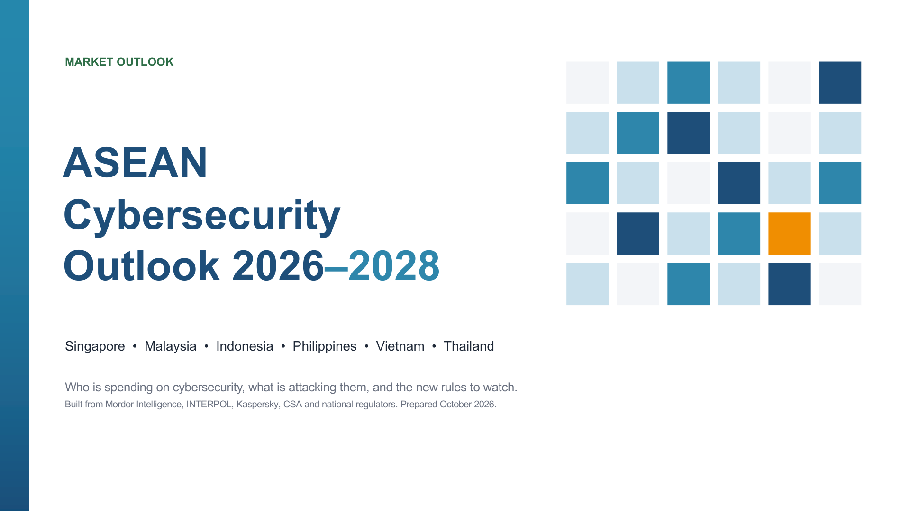
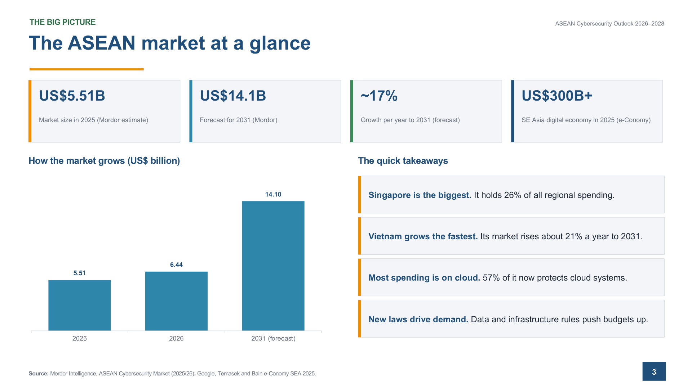
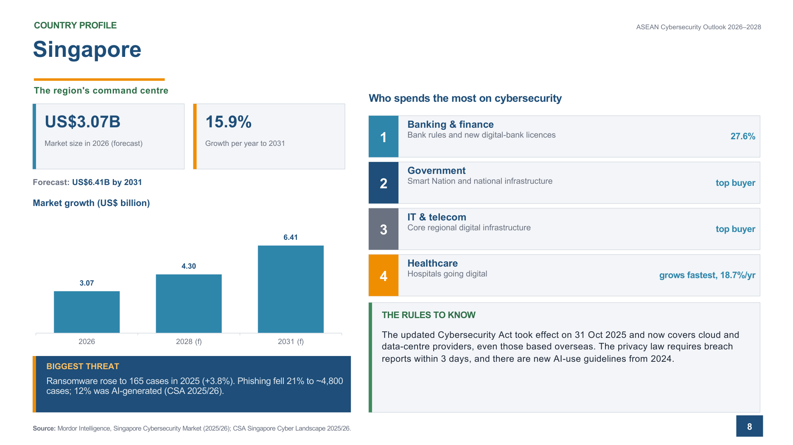
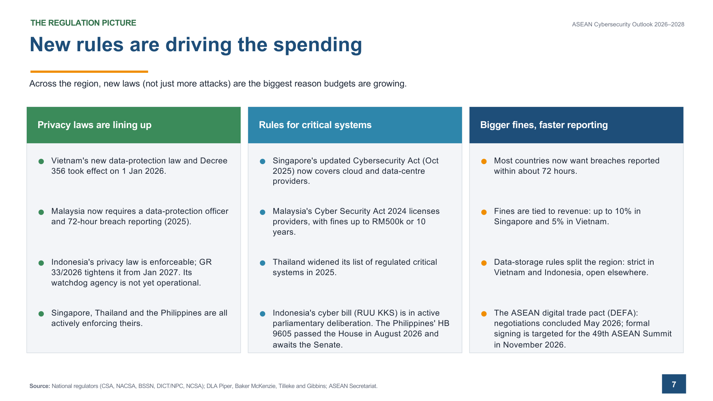
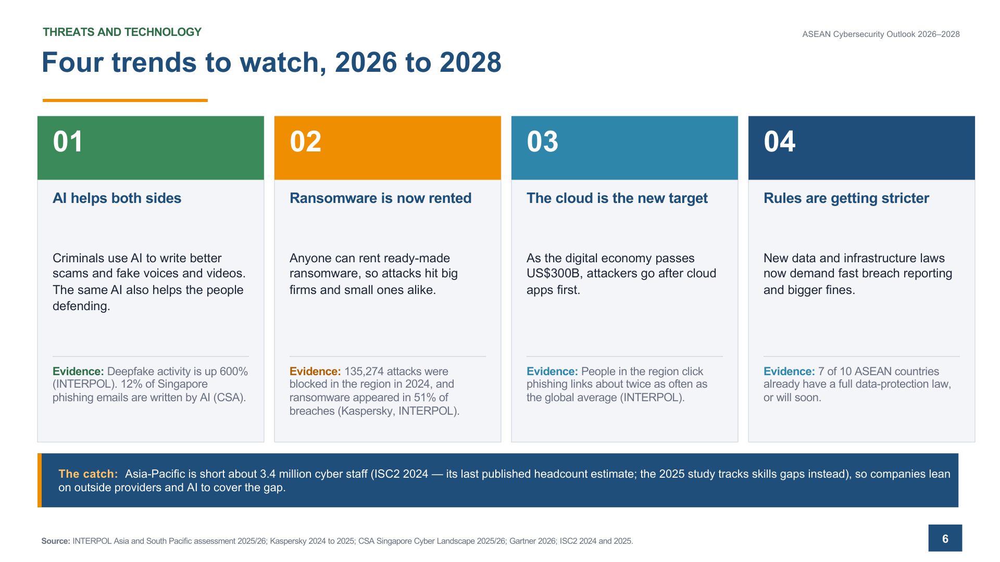
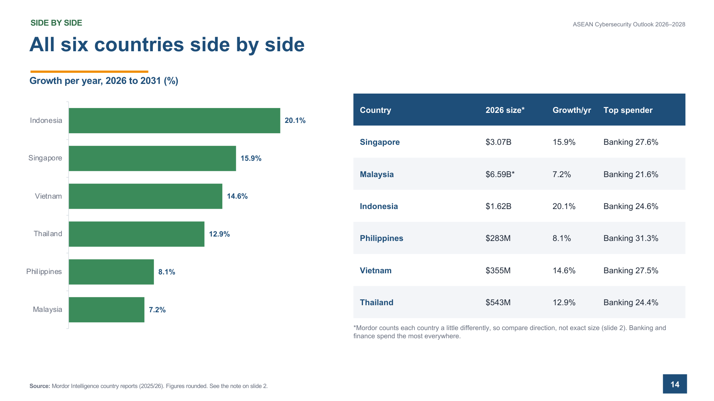

# ASEAN Cybersecurity Outlook 2026–2028

A 16-slide market outlook for **six ASEAN countries** (Singapore, Malaysia, Indonesia, the Philippines, Vietnam and
Thailand): how big each cybersecurity market is and how fast it grows, which industries spend the most, the main
threats, and the new laws driving budgets. The deck is **generated from data by a Python script**, and every figure
in it is traced to a named source and edition in a **source ledger** that was re-checked every month.



**Built with:** Python (python-pptx) for the deck and its native, editable PowerPoint charts; a Markdown source
ledger; PowerPoint for the PDF export.

**Files:** [`build_deck.py`](build_deck.py) (generator) · [`sources.md`](sources.md) (source ledger) ·
[`ASEAN_Cybersecurity_Outlook_2026-2028.pptx`](ASEAN_Cybersecurity_Outlook_2026-2028.pptx) ·
[`ASEAN_Cybersecurity_Outlook_2026-2028.pdf`](ASEAN_Cybersecurity_Outlook_2026-2028.pdf)

---

## What the outlook covers

| Slides | Content |
|---|---|
| 1–2 | Cover; how to read the deck (reported figures vs forecasts vs opinion, and a caveat on market-size definitions) |
| 3 | The regional market at a glance: 2025 size, 2031 forecast, growth rate, digital-economy context |
| 4–5 | Market size by country; banking-and-finance share and the fastest-growing industry per country |
| 6 | Four threat and technology trends (AI on both sides, ransomware-as-a-service, cloud, stricter rules) and the skills gap |
| 7 | Regulation: privacy laws, critical-infrastructure rules, breach reporting and fines |
| 8–13 | One profile per country: size and growth, top industries, biggest threat, the rules to know |
| 14 | All six countries side by side |
| 15 | Takeaways and suggested focus areas (clearly labelled as opinion) |
| 16 | Sources and references |

Every slide carries a source line, and every slide has speaker notes that read as a walkthrough script.



## How the deck is generated from data

`build_deck.py` holds the figures as plain Python data (a list of country records, chart series and text blocks)
and draws every slide with python-pptx: stat cards, native column and bar charts, tables and the speaker notes.
The country profiles (slides 8–13) are one template looped over six records, so all six are laid out the same way
and a changed figure only has to be edited once.

Because the charts are native PowerPoint charts rather than pictures, their data stays inside the `.pptx`: anyone
can open a chart's data sheet and check the numbers.



## Source-ledger discipline

[`sources.md`](sources.md) is the record of every figure in the deck. It holds:

- **Regional figures**, **per-country figures**, **threat figures** and the **regulatory landscape**, each with its
  value, source and the source's edition or date.
- A **source cadence table**: how often each source publishes and its last known update.
- A **change log** of what each monthly check changed, what it confirmed as unchanged, and what is still open.

The rules behind it:

1. **Every number traces to a named source and edition.** Anything that could not be verified was left out or
   flagged (for example, Thailand's attack volume is marked "press, flagged").
2. **One market-size source for all countries** (Mordor Intelligence), so the countries can be compared. Malaysia's
   report uses a wider definition, and the deck says so wherever Malaysia's size appears.
3. **Reported figures, forecasts and opinion are labelled separately** in the deck.
4. **A monthly re-check** compares each source against the ledger and produces a flag-only change report. A moved
   "last updated" stamp is not a data change; only a new edition or a new figure is. Regulation is the volatile
   part (bills pending, agencies not yet set up), so those items are marked **WATCH**.
5. **Ledger first, then script, then rebuild**, so the ledger, the script and the deck always agree.

The figures in this repository are the **baseline as of 1 October 2026**.



## Headline figures

Quoted from the ledger:

| Figure | Value | Source |
|---|---|---|
| ASEAN cybersecurity market, 2025 → 2031 (f) | US$5.51B → US$14.10B, CAGR ~17% (16.95%) | Mordor Intelligence, ASEAN Cybersecurity Market |
| Singapore share of the region | 26.2% (largest) | Mordor Intelligence |
| Singapore ransomware cases, 2025 | 165 (+3.8% YoY, was 159 in 2024) | CSA Singapore Cyber Landscape 2025/26 |
| Malaysia: fraud share of incidents | 85.25% (2,314 of 2,715), Q2 2026 | MyCERT Q2 2026 |
| Asia-Pacific cyber talent gap | ~3.4M (last published headcount estimate) | ISC2 2024 Workforce Study |

Market sizes and growth rates are analyst forecasts; the deck itself says to trust the direction and growth rate
more than any single dollar figure.





## How to rebuild

```bash
python3 -m venv venv
source venv/bin/activate
pip install python-pptx
python build_deck.py                      # writes ASEAN_Cybersecurity_Outlook_2026-2028.pptx next to the script
python build_deck.py out/my_copy.pptx     # or write to another path
```

To update a figure: change it in `sources.md` (value, source, edition, change-log entry), change the same value in
`build_deck.py`, and rebuild. The PDF in this folder was exported from the generated `.pptx` with PowerPoint.
